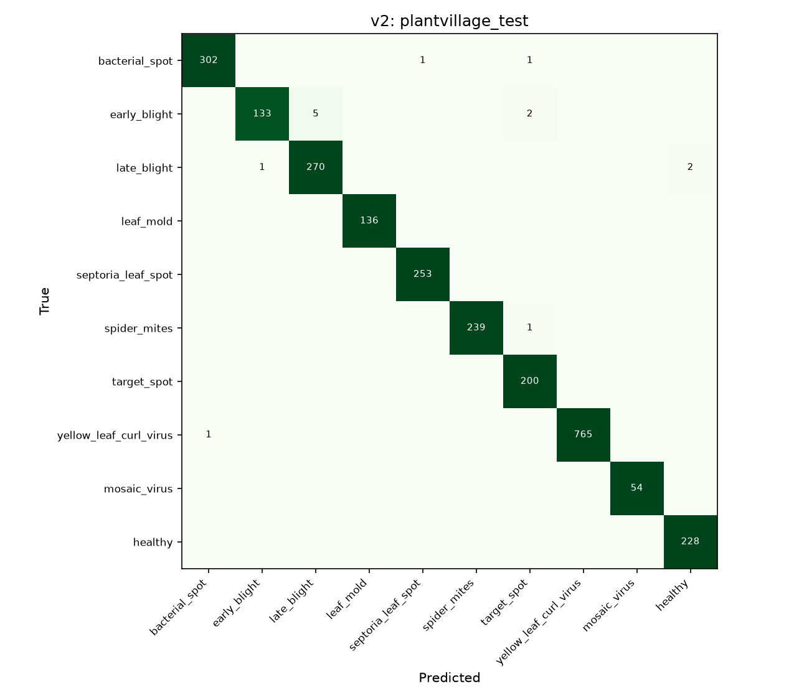
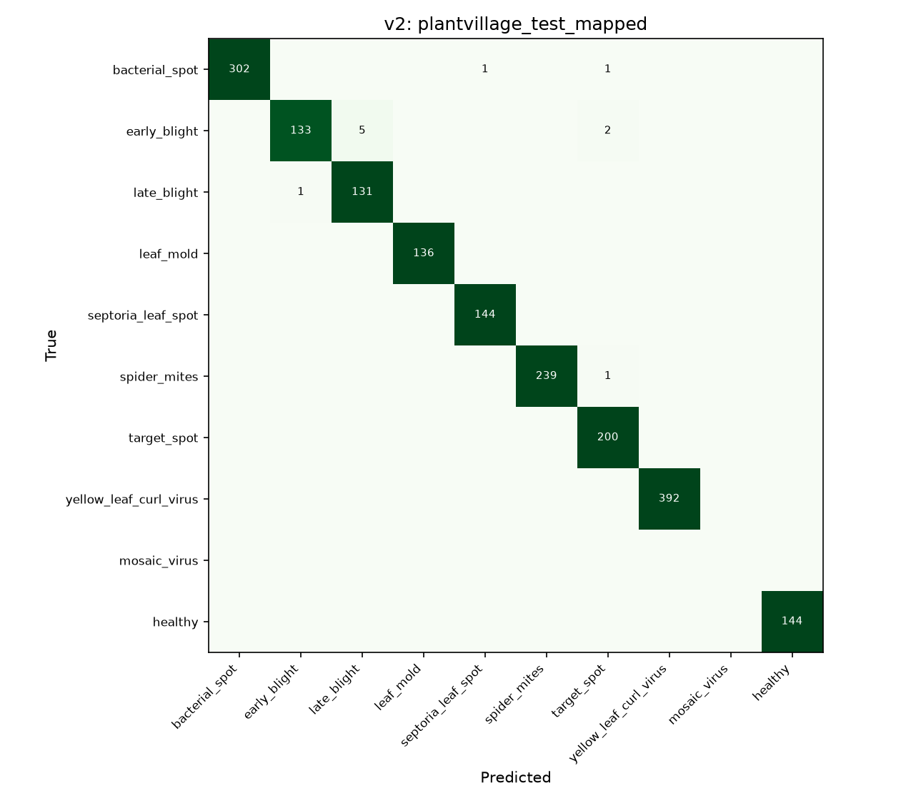
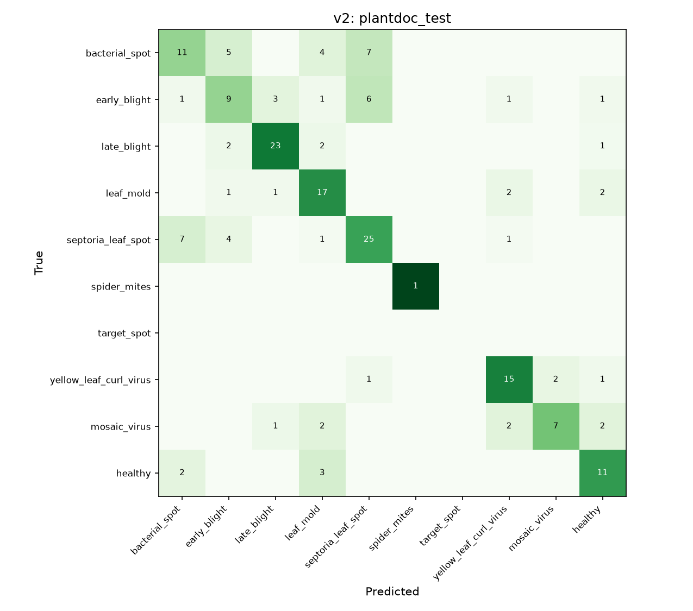

# Tomato CV model results: tomato_cv_v2.0

EfficientNet-B0 fine-tuned on 12,968 PlantVillage + 446 PlantDoc (×6) tomato images with field-photo augmentation. Best epoch 18 (selection score 0.7876), trained 2026-11-16 on NVIDIA GeForce RTX 4060 Laptop GPU in 12.3 min, code commit `4e65444`.

## Summary

| Test set | Images | Accuracy (95% CI) | Macro-F1 |
|---|---:|---:|---:|
| PlantVillage test (all) | 2,594 | 99.5% (99.1%–99.7%) | 0.993 |
| PlantVillage test (leaf-map verified) | 1,832 | 99.4% (98.9%–99.7%) | 0.992 |
| PlantDoc test (real-world, held out) | 188 | 63.3% (56.2%–69.9%) | 0.666 |

## How to read these numbers

- **Splits are grouped:**
  - Every photo of the same leaf (PlantVillage's official leaf map) stays in one split.
  - So does every exact or near-duplicate photo.
  - See `ml/cv/splits.py`.
- **29% of PlantVillage images have no leaf-map entry.** This covers all Mosaic Virus images and about half of Yellow Leaf Curl and Late Blight.
  - For those images, different photos of the same leaf can still land in both train and test.
  - The *leaf-map verified* row only counts test images whose leaf is known.
- **PlantDoc is the real-world number.**
  - Its photos have backgrounds, lighting changes and several leaves per photo.
  - All 746 PlantDoc photos were pooled and split 60/15/25 by group. The 188-photo test split is held out from every model.
  - PlantDoc has no Target Spot images and only 2 Spider Mite images, so those classes can't be judged on it.
- **The test set is small, so the confidence interval matters.** With 188 PlantDoc test photos, differences inside the 95% interval aren't meaningful.

## PlantVillage test (all)

| Class | Precision | Recall | F1 | Images |
|---|---:|---:|---:|---:|
| bacterial_spot | 0.997 | 0.993 | 0.995 | 304 |
| early_blight | 0.993 | 0.950 | 0.971 | 140 |
| late_blight | 0.982 | 0.989 | 0.985 | 273 |
| leaf_mold | 1.000 | 1.000 | 1.000 | 136 |
| septoria_leaf_spot | 0.996 | 1.000 | 0.998 | 253 |
| spider_mites | 1.000 | 0.996 | 0.998 | 240 |
| target_spot | 0.980 | 1.000 | 0.990 | 200 |
| yellow_leaf_curl_virus | 1.000 | 0.999 | 0.999 | 766 |
| mosaic_virus | 1.000 | 1.000 | 1.000 | 54 |
| healthy | 0.991 | 1.000 | 0.996 | 228 |

## PlantVillage test (leaf-map verified)

| Class | Precision | Recall | F1 | Images |
|---|---:|---:|---:|---:|
| bacterial_spot | 1.000 | 0.993 | 0.997 | 304 |
| early_blight | 0.993 | 0.950 | 0.971 | 140 |
| late_blight | 0.963 | 0.992 | 0.978 | 132 |
| leaf_mold | 1.000 | 1.000 | 1.000 | 136 |
| septoria_leaf_spot | 0.993 | 1.000 | 0.997 | 144 |
| spider_mites | 1.000 | 0.996 | 0.998 | 240 |
| target_spot | 0.980 | 1.000 | 0.990 | 200 |
| yellow_leaf_curl_virus | 1.000 | 1.000 | 1.000 | 392 |
| healthy | 1.000 | 1.000 | 1.000 | 144 |

## PlantDoc test (real-world, held out)

| Class | Precision | Recall | F1 | Images |
|---|---:|---:|---:|---:|
| bacterial_spot | 0.524 | 0.407 | 0.458 | 27 |
| early_blight | 0.429 | 0.409 | 0.419 | 22 |
| late_blight | 0.821 | 0.821 | 0.821 | 28 |
| leaf_mold | 0.567 | 0.739 | 0.641 | 23 |
| septoria_leaf_spot | 0.641 | 0.658 | 0.649 | 38 |
| spider_mites | 1.000 | 1.000 | 1.000 | 1 |
| yellow_leaf_curl_virus | 0.714 | 0.789 | 0.750 | 19 |
| mosaic_virus | 0.778 | 0.500 | 0.609 | 14 |
| healthy | 0.611 | 0.688 | 0.647 | 16 |
